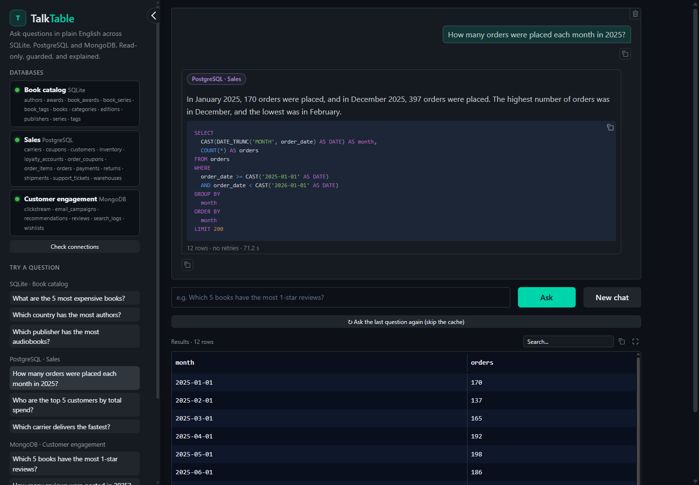
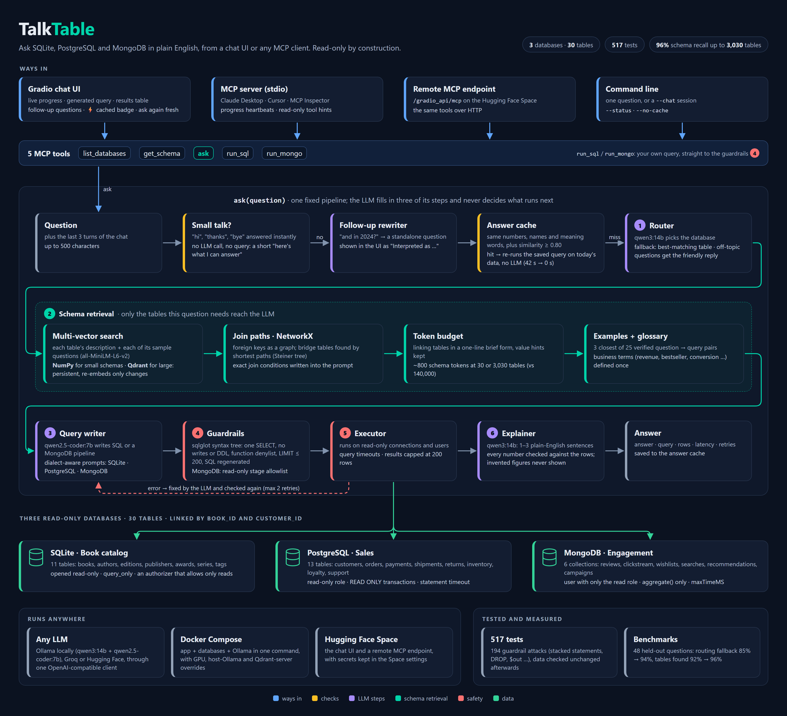

# TalkTable

**Ask questions in plain English across SQLite, PostgreSQL and MongoDB, from a chat UI or
any MCP client. Read-only by construction.**

[](https://www.python.org/)
[](https://modelcontextprotocol.io)
[](https://www.gradio.app/)
[](docs/deploy.md)
[](LICENSE)

**Live demo:** coming soon on Hugging Face Spaces. Until then, [run it locally](#run-locally)
or [deploy your own](docs/deploy.md).



## Why TalkTable

**The problem.** Real data rarely lives in one place. An online bookstore keeps its catalog in
one database, sales in another, and reviews and clickstream in a document store. Answering
"which books get the most 1-star reviews?" means knowing which system holds what, its
schema, and its query language (SQL or MongoDB aggregations). Handing an LLM raw database
access is risky: one bad query can change or delete data.

**The solution.** TalkTable routes each question to the right database, retrieves only the
relevant part of the schema, has an LLM write the query, and **validates it against strict
read-only guardrails before anything runs**. When a query fails, TalkTable fixes it itself,
then explains the result in plain English, checking every number in the answer against
the actual rows. It runs as a Gradio chat app and as an MCP server, so Claude
Desktop, Cursor or your own agents can use the same tools.

## How it works



<sub>Source: [docs/flow.html](docs/flow.html). Open it in a browser to view or edit; the arrows follow the boxes.</sub>

All three databases share `book_id`, so the data tells one consistent story: 30 tables and
collections, generated by seeded, reproducible scripts (`data/seed/`).

## Features

- **Plain English to SQL or MongoDB**, across three engines, with automatic routing.
- **Schema retrieval that scales:** only the tables a question needs reach the LLM. Each
  table is embedded as several vectors (its description, plus each sample question it
  answers), in NumPy for small schemas or **Qdrant** for large ones. The schema stays at
  ~800 tokens whether there are 30 tables or 3,000 ([benchmarks](#benchmarks)).
- **Join paths:** foreign keys form a **NetworkX** graph. The tables that connect the matched
  ones are added, and the join conditions are written out for the LLM.
- **Worked examples retrieved by similarity:** the 3 closest of 25 verified question/query
  pairs go into the prompt, and every one of them is tested against the real databases.
- **Read-only by construction:** guardrails on every query, plus read-only connections and
  users at the database level (see [Safety](#safety)).
- **Self-correction:** failed or rejected queries go back to the LLM with the error, up to
  two times, and every retry is validated again.
- **Grounded answers:** numbers the explainer mentions must appear in the results. If not,
  it retries once, then falls back to a plain summary. Invented figures never reach you.
- **MCP server:** five tools over stdio (`mcp_server.py`) and over HTTP (the Space).
- **Any LLM:** Ollama locally, or Groq / Hugging Face Inference Providers in the cloud, all
  through one OpenAI-compatible client. Optionally use a separate code model just for queries.
- **Follow-up questions:** "and in 2024?" or "what are their titles?" are rewritten into
  standalone questions using the conversation. The UI shows how each one was understood.
  Asking for titles after a MongoDB answer gets the book IDs looked up in SQLite.
- **Answer cache:** a repeated or reworded question ("show me the 5 most expensive books")
  reuses its saved query, re-run on the current data, in well under a second instead of a
  minute. It never matches when numbers, years, names or meaning words differ: "2024" vs
  "2025" or "cheapest" vs "most expensive" are always answered afresh.
- **Business glossary:** terms like *revenue*, *bestseller*, *conversion* or *repeat
  customer* are defined once in `descriptions.yaml`. Their definitions are added to the
  prompt whenever a question uses them.
- **Knows what it's for:** greetings and off-topic questions get a short "here's what I can
  answer" reply instead of a made-up query.
- **Chat UI** with live progress, database badges, the generated query, a results table,
  retries and latency.

## MCP tools

| Tool | Arguments | Returns |
|---|---|---|
| `list_databases` | – | Each database: name, kind, online status, description, tables/collections |
| `get_schema` | `database` | Tables or collections with columns/fields, types, descriptions, keys, row counts |
| `ask` | `question` | Answer, database(s) and query used, rows, retries, latency |
| `run_sql` | `database`, `query` | Rows from your own `SELECT` on `sqlite` / `postgres`, after the guardrails |
| `run_mongo` | `collection`, `pipeline` | Documents from your own aggregation pipeline, after the guardrails |

An MCP client like Claude can call `ask`, or explore with `get_schema` and write its own
queries with `run_sql` / `run_mongo`, which also lets it combine data across databases.
Hand-written queries go through exactly the same guardrails.

## Example questions

| Book catalog (SQLite) | Sales (PostgreSQL) | Engagement (MongoDB) |
|---|---|---|
| What are the 5 most expensive books? | How many orders were placed each month in 2025? | Which 5 books have the most 1-star reviews? |
| Which country has the most authors? | Who are the top 5 customers by total spend? | How many reviews were posted in 2025? |
| How many books are there in each category? | Which city has the most customers? | Which device is used for the most browsing sessions? |
| Which publisher has the most audiobooks? | Which carrier delivers the fastest? | Which books are on the most wishlists? |
| Which genre has won the most awards? | What is the most common reason for returns? | What do people search for most? |

## Safety

It must be impossible to modify data through TalkTable, so there are two independent layers.

**1. Guardrails (`talktable/guardrails.py`), applied to every query, generated or hand-written:**

- *SQL:* parsed with [sqlglot](https://github.com/tobymao/sqlglot) into a syntax tree.
  - Exactly one statement, and it must be a `SELECT` (or `UNION`/`WITH … SELECT`).
  - The whole tree is searched for writes, DDL, `PRAGMA`, `ATTACH`, `COPY`, `SET`,
    transactions and `SELECT … INTO`.
  - Dangerous functions are blocked (`pg_*`, `lo_*`, `dblink`, `load_extension`, …).
  - Tables must exist and come from the app's own schema.
  - The final `LIMIT` is capped at 200.
  - The SQL that runs is **regenerated from the validated tree with comments removed**, so
    comment tricks and stacked statements can't survive. It is then parsed and checked once
    more.
- *MongoDB:*
  - Only 11 read stages are allowed (`$match`, `$group`, `$lookup`, `$facet`, …).
  - `$out`, `$merge`, `$function`, `$where`, `$accumulator` and JavaScript code are rejected
    at any depth.
  - The collection must exist, and the output is capped at 200 documents.

**2. The databases themselves are read-only for TalkTable:**

- *SQLite:* opened with `mode=ro`, plus `PRAGMA query_only`, an authorizer that only
  allows reads, and a query timeout.
- *PostgreSQL:* a dedicated read-only role (`default_transaction_read_only`), every
  transaction `READ ONLY`, and a `statement_timeout`.
- *MongoDB:* a user with only the `read` role, `aggregate()` only, and `maxTimeMS`.

So even a query that slipped past the guardrails would be refused by the database.
There are **194 guardrail tests** (stacked statements, comment tricks, `DROP`, `DELETE`,
`$out`, `$merge`, `$where`, …), and the test suite checks that the data is unchanged
afterwards. Errors shown to users are friendly messages, never stack traces. Credentials are
kept out of logs and code (`SecretStr`, masked URLs, `.env` is git-ignored).

## Run locally

**With Docker, one command:** the app, PostgreSQL, MongoDB and Ollama, all on your machine
(details and GPU options in [docs/docker.md](docs/docker.md)):

```bash
git clone https://github.com/grishika21/talktable && cd talktable
docker compose up --build              # then open http://127.0.0.1:7860
```

**For development**, which needs Python 3.11 and Docker (Ollama is optional):

```bash
git clone https://github.com/grishika21/talktable && cd talktable
python3.11 -m venv .venv && .venv/bin/pip install -r requirements.txt
cp .env.example .env                   # local defaults; see the comments inside

docker/dev-db.sh up                    # PostgreSQL + MongoDB in Docker, with read-only users
.venv/bin/python -m data.seed.seed_all # fill all three databases

# LLM: local Ollama (tested: qwen3:14b + qwen2.5-coder:7b), or set LLM_PROVIDER=groq in .env
ollama pull qwen3:14b && ollama pull qwen2.5-coder:7b

.venv/bin/python app.py                # chat UI on http://127.0.0.1:7860 (+ MCP at /gradio_api/mcp)
.venv/bin/python -m talktable.cli "Which 5 books have the most 1-star reviews?"
```

Try a conversation in the terminal with `.venv/bin/python -m talktable.cli --chat`.

Tests: `.venv/bin/python -m pytest` runs 513 fast tests against the real databases with a
scripted LLM. `TALKTABLE_LIVE_TESTS=1 .venv/bin/python -m pytest -m live` also runs the demo
questions through the real LLM.

## Connect to Claude Desktop

**Local (stdio).** Add this to `claude_desktop_config.json` (Settings, then Developer, then
Edit Config), and restart Claude Desktop:

```json
{
  "mcpServers": {
    "talktable": {
      "command": "/path/to/talktable/.venv/bin/python",
      "args": ["/path/to/talktable/mcp_server.py"]
    }
  }
}
```

On Windows with TalkTable inside WSL, use `"command": "wsl.exe"` with
`"args": ["-d", "Ubuntu-20.04", "-e", "/home/<you>/talktable/.venv/bin/python", "/home/<you>/talktable/mcp_server.py"]`.

**Remote (a deployed Space).** Use `https://<hf-username>-talktable.hf.space/gradio_api/mcp`
in any client that supports remote MCP servers, or bridge it for Claude Desktop with
[`mcp-remote`](https://www.npmjs.com/package/mcp-remote). The public demo Space is coming
soon; [docs/deploy.md](docs/deploy.md) shows how to run your own.

```json
{
  "mcpServers": {
    "talktable": {
      "command": "npx",
      "args": ["-y", "mcp-remote", "https://<hf-username>-talktable.hf.space/gradio_api/mcp"]
    }
  }
}
```

More detail, including MCP Inspector: [docs/mcp.md](docs/mcp.md).

## Deploy your own

[docs/deploy.md](docs/deploy.md) walks through it step by step:
1. PostgreSQL on Neon and MongoDB on Atlas, each with a **read-only user**.
2. Seed them from your laptop.
3. Get a Groq or Hugging Face key.
4. Create the Space, add the secrets, and upload.

## Benchmarks

Measured on a laptop (CPU embeddings, all-MiniLM-L6-v2); no LLM involved. Rerun with
`python -m eval.benchmark_retrieval` and `python -m eval.benchmark_scale`.

**Retrieval on the 30 demo tables**, using 48 held-out questions worded differently from
anything in `descriptions.yaml` (`eval/retrieval_questions.yaml`):

| | One vector per table | One vector per text + join graph |
|---|---|---|
| Embedding fallback picks the right database | 85% | **94%** |
| All tables the query needs are shown | 92% | **96%** |
| ... for questions that need 2–4 tables | 80% | **87%** |
| Schema tokens in the prompt (every table: ~1,570) | ~780 | **~730**, join conditions included |

**Growing the schema** with synthetic tables (HR, finance, logistics, store operations, …,
with foreign keys and sample questions) mixed in with the real ones:

| Tables | All needed tables found | Schema tokens in the prompt | Sending every table instead |
|---:|---:|---:|---:|
| 30 | 96% | ~730 | ~1,566 |
| 330 | 96% | ~784 | ~15,438 |
| 1,030 | 96% | ~810 | ~47,860 |
| 3,030 | 96% | ~805 | ~140,114 |

| Tables | Vectors | Start-up: NumPy (every start) | Start-up: Qdrant embedded (first / restart) | Start-up: Qdrant server (first / restart) | Search: NumPy | Search: Qdrant embedded | Search: Qdrant server |
|---:|---:|---:|---:|---:|---:|---:|---:|
| 30 | 119 | 1.9 s | 2.3 s / 0.0 s | 2.5 s / 0.0 s | 0.3 ms | 4.7 ms | 8.9 ms |
| 330 | 1,019 | 5.0 s | 9.1 s / 0.1 s | 6.0 s / 0.0 s | 0.4 ms | 39.7 ms | 8.9 ms |
| 1,030 | 3,119 | 10.2 s | 22.6 s / 0.3 s | 12.1 s / 0.1 s | 0.6 ms | 200.3 ms | 9.8 ms |
| 3,030 | 9,119 | 27.5 s | 114.5 s / 1.3 s | 32.8 s / 0.4 s | 1.4 ms | 406.4 ms | 12.9 ms |

What this shows:
- **The approach holds up.** Recall stays at 96% with 100 times as many tables, and the prompt
  stays at ~800 schema tokens instead of growing to 140,000.
- **NumPy is the right default for small schemas:** the fastest search, and nothing to run.
  Its cost is start-up, because it embeds everything again on every start.
- **A Qdrant server is the right choice for large ones:** restarts re-embed nothing, and
  search stays at a few milliseconds at any size. Embedded Qdrant persists too, but its search
  runs in Python and slows down past ~1,000 tables.
- **Where it still misses:** 2 of the 48 questions. "books labelled 'classic'" doesn't find
  the tags table, and "orders that were later returned" doesn't find returns. End to end
  with the local LLMs, 9 of 10 multi-table and new-table questions matched hand-written
  ground truth; the miss was that second question.

## Design notes

- **One vector per sample question, not one per table.** A table embedded as a single
  chunk of description and columns gets diluted: "Which books are out of stock?" matched
  the books table (0.52) better than inventory (0.51), whose description talks about
  warehouses and reorder levels. Embedded on its own, inventory's sample question "Which
  books are out of stock?" scores 1.0. So every table gets several vectors, scores as its best
  one, and a database scores as its best table. On held-out questions, routing went from
  85% to 94% and finding every table a query needs from 92% to 96%.
- **NumPy for small schemas, Qdrant for large ones.** Both sit behind one `VectorStore`
  interface and give identical results (tested). NumPy is exact and the fastest (1.4 ms
  per question with 9,000 vectors), but it embeds every table again at each start-up: 28 s
  for 3,000 tables on a laptop CPU. Qdrant keeps the vectors and re-embeds only tables whose
  text changed (by content hash). A Qdrant server answers in 9–13 ms at any size and can
  be shared by several app processes. `VECTOR_STORE=auto` picks Qdrant when `QDRANT_URL` is
  set or a schema reaches 300 tables. Embedded Qdrant (no server) persists too, but searches
  in Python and gets slow past ~1,000 tables, so large deployments should run the server
  (`docker-compose.qdrant.yml`).
- **Join paths from a graph, not from the LLM's guesses.** Foreign keys become a NetworkX
  graph. The matched tables are connected through a greedy Steiner tree: each one joins by
  its shortest path, at most 3 hops, and at most 3 bridge tables are added. "What is the
  average satisfaction score of gold tier members?" matches `support_tickets` and
  `loyalty_accounts`; the graph adds `customers`, which links them, and the prompt lists the
  exact join conditions. Bridge and lookup tables are shown in one line each (keeping any
  notes that quote values, since a filter needs the exact spelling: `'United States'`, not
  `'USA'`), and the schema is trimmed to a 2,000-token budget.
- **Embeddings pick tables; words decide cache hits.** Similarity is good at "which tables
  is this about?". It's bad at telling "2024" from "2025": they score 0.99, while a true
  paraphrase scores 0.74. So the cache requires identical numbers, names and meaning words,
  and uses similarity only as a final check.
- **A pipeline, not an agent.** Every question takes the same steps, which keeps it fast,
  testable and predictable. The LLM fills in three of them and never decides what runs next.

## Tech stack

Python 3.11 · [MCP Python SDK](https://github.com/modelcontextprotocol/python-sdk) (FastMCP) ·
Gradio 6 with MCP · SQLAlchemy 2 + psycopg 3 · PyMongo · sqlglot · sentence-transformers
(all-MiniLM-L6-v2) · NumPy and [Qdrant](https://qdrant.tech) (vector search) · NetworkX (join
paths) · OpenAI-compatible client for Ollama / Groq / Hugging Face · Pydantic v2 +
pydantic-settings · Faker · pytest

```
talktable/        the engine: adapters/, guardrails, router, schema_index (+ vector_store,
                schema_graph), generator, executor, explainer, pipeline, tools (MCP tools),
                webui (Gradio), cli
app.py          Hugging Face Space entry point: chat UI + remote MCP server
mcp_server.py   stdio MCP server (Claude Desktop, Cursor, MCP Inspector)
data/           bookstore.db, descriptions.yaml (schema docs for the LLM), seed/
docker/         Dockerfile, plus local PostgreSQL + MongoDB with read-only users
docker-compose.yml  the whole stack (app, databases, Ollama) in one command
eval/           retrieval benchmarks: held-out questions, and synthetic schemas up to 3,000 tables
tests/          517 tests: guardrails, adapters, retrieval, join paths, vector stores, routing,
                pipeline, follow-ups, cache, MCP, web UI
```

## Roadmap

- Cross-database questions: join review counts (MongoDB) with book titles (SQLite)
  in one answer.
- Automatic charts for numeric results.
- An "approve before run" mode that shows the query and runs it on confirmation.

## License and author

MIT, see [LICENSE](LICENSE).

Built by **Rishika Guggilam**:
[LinkedIn](https://www.linkedin.com/in/rishika-guggilam) · [GitHub](https://github.com/grishika21)
